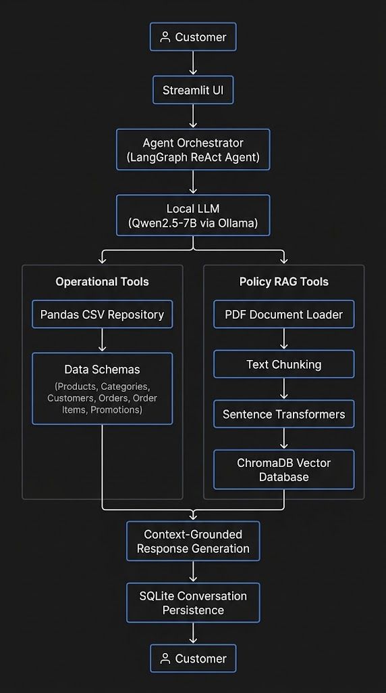

# Empório da Música — AI Customer Support Agent

A locally hosted, multilingual AI customer support assistant for **Empório da Música**, a fictional musical instrument store based in Campo Grande, Mato Grosso do Sul, Brazil.

This project demonstrates a hybrid AI architecture combining **Retrieval-Augmented Generation (RAG)** and **Agentic Tool Use (Function Calling)** to answer customer questions using structured operational data and internal business documentation.

The application uses free and open-source technologies and runs locally without requiring paid LLM APIs.

---

## 1. Project Overview

The goal of this project is to build an AI-powered customer support assistant capable of understanding customer requests, retrieving relevant information from different data sources, and generating natural, context-aware responses.

The assistant can help customers with:

- Product discovery and catalog searches.
- Product descriptions, specifications, and prices.
- Product availability and inventory.
- Active promotions and discounts.
- Order status and delivery information.
- Store policies and customer service procedures.
- Store information available in the internal documentation.

The system combines two information retrieval approaches:

| Information source | Approach | Technology |
|---|---|---|
| Operational data | Structured queries | Pandas and CSV |
| Internal documentation | Semantic retrieval | RAG, Sentence Transformers, and ChromaDB |

A locally hosted Large Language Model acts as the reasoning and response-generation layer, while specialized Python tools retrieve factual information from the appropriate sources.

**Core principle:** The assistant should rely on retrieved information and tool results rather than inventing business facts, policies, product details, or operational actions.

---

## 2. System Architecture

The application follows a modular architecture in which the agent coordinates the interaction between the language model and the available tools.




### 2.1 Agentic Tool Use

The agent is implemented using **LangGraph** and follows the ReAct (Reasoning and Acting) approach.

Rather than relying exclusively on the LLM's internal knowledge, the agent can select and execute specialized tools to retrieve information from the store's data sources.

The current tool layer includes:

| Tool | Responsibility |
|---|---|
| `search_products` | Search the product catalog using keywords and filters. |
| `get_product_price` | Retrieve product pricing information. |
| `check_stock` | Check product inventory. |
| `get_active_promotions` | Retrieve active product promotions. |
| `get_order_status` | Retrieve order information after validating the order ID and customer email. |
| `get_customer_orders` | Retrieve a customer's order history. |
| `search_store_policies` | Search the internal policy knowledge base. |
| `get_store_information` | Retrieve store information from the internal documentation. |

The Python tools handle data access and business queries, while the LLM interprets customer requests, selects the appropriate tools, and generates conversational responses.

### 2.2 Retrieval-Augmented Generation (RAG)

The RAG component provides access to the store's internal customer service manual in PDF format.

The retrieval pipeline follows these steps:

1. Load the PDF using PyMuPDF.
2. Extract the document text.
3. Split the extracted content into smaller text chunks.
4. Generate multilingual vector embeddings.
5. Store the embeddings in ChromaDB.
6. Retrieve relevant chunks using semantic similarity search.
7. Provide the retrieved context to the agent for answer generation.

The embedding model is:

`sentence-transformers/paraphrase-multilingual-MiniLM-L12-v2`

This model supports multilingual semantic retrieval, allowing the assistant to process Portuguese source documentation and answer customers in English or other supported languages.

ChromaDB persists the vector index locally so that it can be reused between application executions.

---

## 3. Technology Stack

The project uses free and open-source technologies.

| Component | Technology | Purpose |
|---|---|---|
| Programming language | Python 3.11 | Application development |
| Local LLM runtime | Ollama | Local model execution |
| Language model | Qwen2.5 7B Instruct | Reasoning and response generation |
| Agent orchestration | LangGraph | Agent workflow and tool coordination |
| LLM framework | LangChain | Model and tool integration |
| Structured data processing | Pandas | CSV loading and querying |
| PDF extraction | PyMuPDF | Document text extraction |
| Embeddings | Sentence Transformers | Multilingual semantic representations |
| Vector database | ChromaDB | Persistent vector storage |
| Conversation persistence | SQLite | Conversation history storage |
| User interface | Streamlit | Web-based chat interface |
| Testing | Pytest | Automated testing |
| Configuration | python-dotenv | Environment variable management |

### Language Model

The default conversational model is:

`qwen2.5:7b-instruct`

It runs locally through Ollama, eliminating the need for a paid external LLM API.

### Embedding Model

The RAG pipeline uses:

`sentence-transformers/paraphrase-multilingual-MiniLM-L12-v2`

The embedding model runs locally and is independent of the conversational LLM.

---

## 4. Project Structure

```text
emporio-da-musica-agent/
│
├── app.py
├── requirements.txt
├── .env.example
├── .gitignore
├── README.md
│
├── data/
│   ├── categories.csv
│   ├── customers.csv
│   ├── orders.csv
│   ├── order_items.csv
│   ├── products.csv
│   ├── promotions.csv
│   └── store_policies_source.pdf
│
├── src/
│   ├── agent/
│   │   ├── orchestrator.py
│   │   ├── prompts.py
│   │   └── tools.py
│   │
│   ├── database/
│   │   └── csv_repository.py
│   │
│   ├── rag/
│   │   ├── document_loader.py
│   │   └── retriever.py
│   │
│   └── memory/
│       └── conversation.py
│
├── storage/
│   ├── chroma/
│   └── conversations.db
│
└── tests/
    ├── test_csv_repository.py
    ├── test_agent_tools.py
    ├── test_rag.py
    └── test_agent_integration.py
```

*The structure illustrates the logical organization of the project. Generated database files and local vector indexes are runtime artifacts.*

---

## 5. Data Sources

The application uses six CSV files containing fictional operational data.

| File | Description |
|---|---|
| `products.csv` | Product catalog, descriptions, specifications, prices, stock quantities, and product status. |
| `categories.csv` | Product category definitions. |
| `customers.csv` | Customer records and contact information. |
| `orders.csv` | Order dates, statuses, totals, payment methods, and delivery information. |
| `order_items.csv` | Products and quantities associated with orders. |
| `promotions.csv` | Product discounts and promotion status. |

The internal customer service manual is provided as:

`data/store_policies_source.pdf`

It contains the store's customer service policies and procedures.

### Source Language

The original CSV and PDF files are maintained in Portuguese.

The assistant is designed to understand information from these Portuguese-language sources and communicate with customers in their requested language.

### Structured Data Access

The `CSVRepository` class centralizes access to the operational CSV files.

It provides deterministic Python methods for:

- Product searches.
- Product detail retrieval.
- Inventory checks.
- Promotion retrieval.
- Order verification.
- Customer order queries.

This separation reduces the need for the LLM to interpret raw CSV files directly.

The CSV files represent a local data snapshot and are not automatically synchronized with a live store management system.

---

## 6. Multilingual Conversation

The application includes language detection and language instructions to support multilingual customer interactions.

The conversational layer is designed to:

- Detect the customer's language.
- Respond in the requested language.
- Maintain language consistency throughout the conversation.
- Understand information retrieved from Portuguese documentation.
- Preserve product names, model names, brand names, identifiers, and monetary values.

The application also maintains conversational history using SQLite.

This allows the agent to use previous messages as conversational context rather than treating every interaction as an isolated request.

---

## 7. Reliability and Business Rules

A central design objective is to prevent the assistant from presenting unsupported information as fact.

### Grounded Responses

The assistant should use the appropriate source for each type of question:

| Customer question | Expected source |
|---|---|
| Product price | Product CSV |
| Product availability | Product CSV |
| Active promotion | Promotions CSV |
| Order status | Orders CSV with customer verification |
| Return and exchange policy | Internal policy PDF |
| Warranty conditions | Internal policy PDF |
| Store contact information | Internal documentation |

When the available sources do not contain an answer, the assistant should clearly communicate that the information could not be verified.

### Order Verification

The order-status functionality checks both:

- The order ID.
- The customer's email address associated with that order.

This validation is intended to prevent unauthorized disclosure of order information.

**Security note:** The current `get_customer_orders` repository method accepts an email address and returns the associated orders without requiring an order ID. This method needs additional verification before it can be used to disclose order history securely.

### Business Information

The assistant must not invent:

- Refund processing times.
- Return requirements not stated in the manual.
- Store opening hours.
- Product availability.
- Services not confirmed by the store.
- External recommendations that have not been researched.

The language model is responsible for communicating retrieved facts naturally, not creating missing business policies.

---

## 8. Installation and Setup

### Prerequisites

Install the following:

- Python 3.11
- Git
- Ollama

Ollama download:

https://ollama.com/

### Step 1. Clone the repository

```bash
git clone <YOUR_REPOSITORY_URL>
cd emporio-da-musica-agent
```

### Step 2. Create a virtual environment

On Windows PowerShell:

```powershell
python -m venv .venv
```

Activate it:

```powershell
.venv\Scripts\Activate.ps1
```

### Step 3. Install dependencies

```powershell
python -m pip install --upgrade pip
pip install -r requirements.txt
```

### Step 4. Download the LLM

Start Ollama and execute:

```powershell
ollama pull qwen2.5:7b-instruct
```

Verify the installation:

```powershell
ollama list
```

### Step 5. Configure environment variables

Create a `.env` file in the project root based on `.env.example`.

Example:

```env
OLLAMA_BASE_URL=http://localhost:11434
OLLAMA_MODEL=qwen2.5:7b-instruct

EMBEDDING_MODEL=sentence-transformers/paraphrase-multilingual-MiniLM-L12-v2

DATA_DIR=data
POLICY_PDF=data/store_policies_source.pdf

CHROMA_DIR=storage/chroma
SQLITE_PATH=storage/conversations.db
```

Make sure the paths correspond to the actual project structure.

### Step 6. Verify Ollama

Check that the local Ollama API is available:

```powershell
Invoke-RestMethod http://localhost:11434/api/tags
```

The response should include the installed Qwen model.

**Windows networking note:** If a proxy is configured on the machine, local Ollama requests must bypass it. The application should include `localhost` and `127.0.0.1` in both `NO_PROXY` and `no_proxy` before initializing the local LLM client.

---

## 9. Running the Application

From the project root, execute:

```powershell
streamlit run app.py
```

Open the local URL provided by Streamlit, typically:

```text
http://localhost:8501
```

The first execution may take longer because the embedding model needs to be downloaded and the ChromaDB index needs to be created.

Subsequent executions can reuse the persisted vector index when the source PDF has not changed.

---

## 10. Testing

The project includes automated tests covering repository logic, agent tools, retrieval functionality, and agent integration.

Run the complete test suite:

```powershell
python -m pytest -v
```

### LLM Integration Tests

The real LLM integration test can be enabled using:

```powershell
$env:RUN_LLM_TESTS="1"
python -m pytest tests/test_agent_integration.py -v
```

After execution, disable the environment variable:

```powershell
Remove-Item Env:RUN_LLM_TESTS
```

These tests require:

- Ollama to be running.
- The configured model to be installed.
- The local application dependencies to be available.

### Test Results

During development, the following results were obtained:

- 25 tests passed.
- 1 test skipped in the regular test run.
- 12 integration tests passed when the real LLM test suite was enabled.

These results represent the development test runs and may change as the implementation evolves.

---

## 11. Current Limitations

This project is a local prototype built around a fictional store dataset. It is not connected to a production e-commerce platform.

Current limitations include:

- Operational data is stored in static CSV files.
- Inventory and order information are not synchronized with a live system.
- RAG quality depends on PDF extraction, chunking, and retrieval relevance.
- The LLM may still generate unsupported statements if retrieval and tool outputs are insufficiently constrained.
- Customer order history requires stronger verification before secure disclosure.
- Product category synonym matching requires additional refinement to distinguish similar categories reliably.
- The assistant cannot execute purchases, refunds, cancellations, or inventory modifications.
- External services and third-party recommendations are not integrated.

---

## 12. Future Improvements

Potential improvements include:

1. Strengthen order-history verification.
2. Improve multilingual product search and category synonym matching.
3. Add metadata-aware retrieval and refine document chunking.
4. Introduce evidence validation before returning policy-related answers.
5. Add regression tests for contradictory, missing, and ambiguous policy information.
6. Improve observability for agent decisions, tool calls, and retrieved documents.
7. Replace static CSV files with a production database or store API.
8. Add human handoff for unresolved or sensitive customer requests.
9. Evaluate retrieval precision, tool-selection accuracy, and factual consistency.
10. Improve conversation memory management and session handling.

---

## 13. Cost and Local Execution

The default implementation is designed to run locally using free and open-source technologies.

| Component | Cost |
|---|---|
| Python | Free |
| Ollama | Free |
| Qwen2.5 7B Instruct | Locally executed model |
| LangChain | Open source |
| LangGraph | Open source |
| Pandas | Open source |
| PyMuPDF | Open source |
| Sentence Transformers | Open source |
| ChromaDB | Open source |
| SQLite | Free |
| Streamlit | Open source |

No paid LLM API key is required for the default configuration.

Local execution does require sufficient hardware resources, particularly RAM, disk space, and processing capacity for the language and embedding models.

---

## 14. Project Objective

This project demonstrates a practical hybrid AI customer support architecture combining:

- Local Large Language Models.
- Agentic reasoning and function calling.
- Retrieval-Augmented Generation.
- Structured data access.
- Multilingual conversational interaction.
- Persistent conversation history.
- Automated testing.

The central architectural principle is to use the LLM for language understanding, reasoning, and response generation while delegating factual retrieval and business data access to specialized, verifiable components.

**The result is a modular, locally runnable AI customer support assistant designed to provide natural, context-aware, and evidence-grounded responses.**

